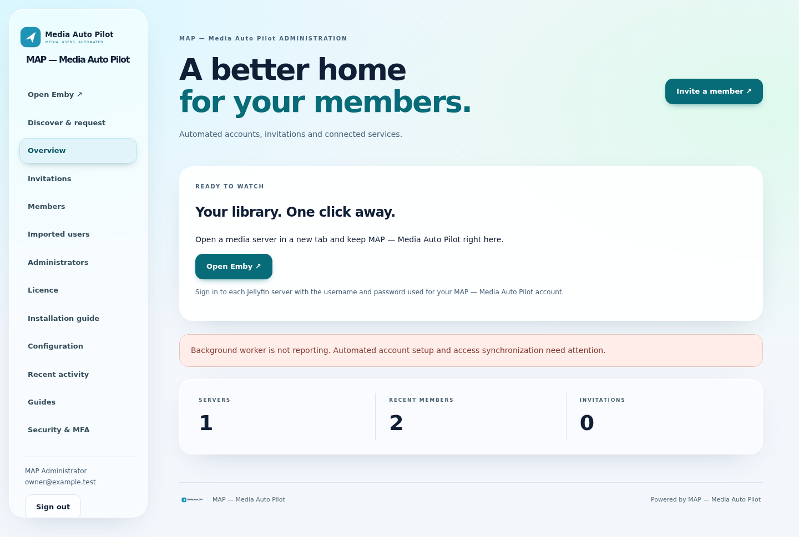
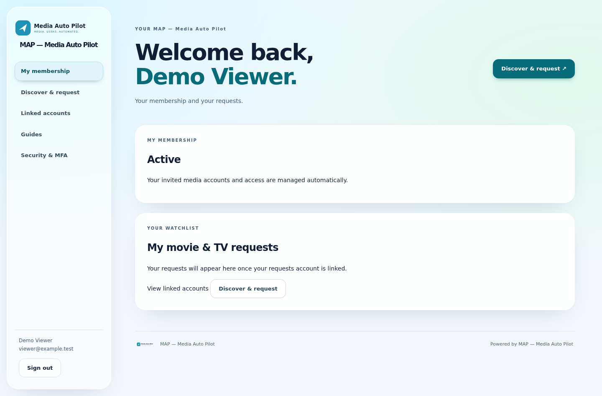
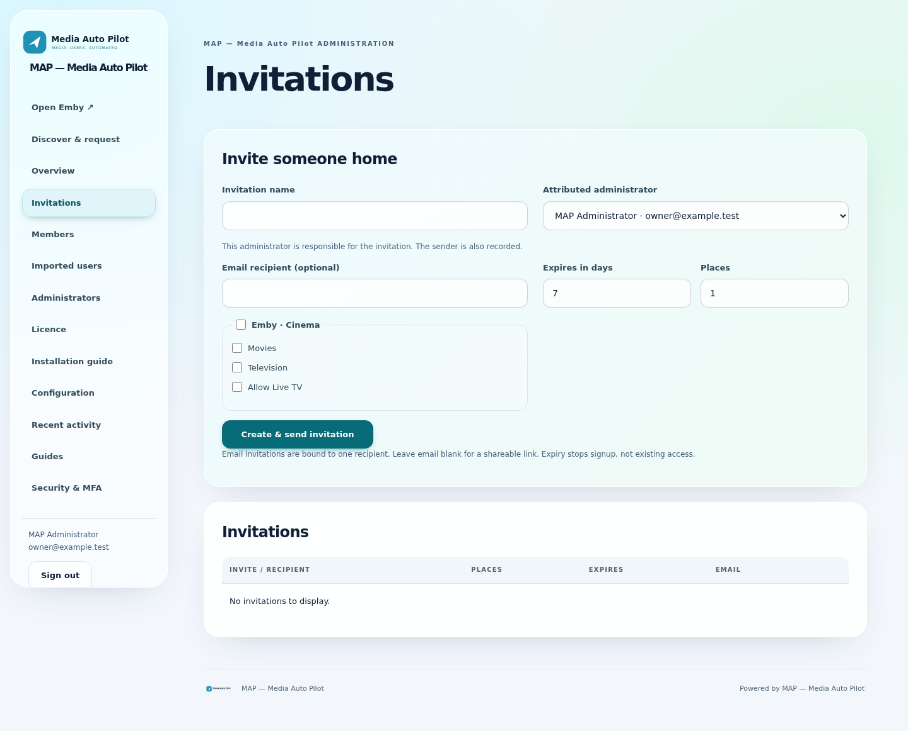

# Media Auto Pilot — MAP 1.0.1

**Automated Emby and Jellyfin user management.**

[Website](https://www.mediaautopilot.co.uk) · [Downloads](https://github.com/matty03072/MediaAutoPilot-Store/releases/tag/installers-1.0.1) · [Licence account](https://www.mediaautopilot.co.uk/map/account)

MAP automates invitations, account creation, per-server library access, password synchronization and account cleanup. Connect Ombi, Sonarr and Radarr for requests and media management. Provider verification, account conflicts and service outages can still need administrator attention.

## No member billing

MAP has no Admin Revenue, Monthly Plans or member checkout. Up to ten managed members are free. A separate MAP software licence is required above ten: £5/month for up to three installations.

## Downloads

Use the Windows x64 installer or Ubuntu 24.04 x64 archive from the release linked above. Verify `SHA256SUMS.txt` before installation. Follow the included platform README and [online installation guide](https://www.mediaautopilot.co.uk/install).

**MAP is a new, separate installation—not an MPS update.** Do not share MPS databases, configuration or state directories. Existing MPS installations are unchanged.

## Install on Umbrel

Add this repository as a community app store:

https://github.com/matty03072/MediaAutoPilot-Store

Install **Media Auto Pilot**, then open it. Unlock setup with username `owner` and the password shown by Umbrel, create your permanent owner account and enrol MFA. MAP uses its own app ID and port 18100, so it can coexist with MPS.

This is an independent community preview, not an official Umbrel App Store release. Default access requires Umbrel login. Public member access needs separate HTTPS configuration.

## Interface

Screenshots use isolated demonstration accounts in the MAP 1.0.1 application; they are not captures of customer data.

## Source protection and reporting

This public repository contains distribution metadata, documentation and compiled downloads—not first-party application source. Source is maintained privately. Runtime modules are compiled and audited for source/bytecode exclusion; compilation does not guarantee protection against reverse engineering.

Free and licensed installations report an installation identifier, version, timestamp and verification signature. Member details, media activity and integration credentials are not included. See the software licence and website privacy notice.

See [release notes](docs/RELEASE-1.0.1.md) for verification results and limitations.
