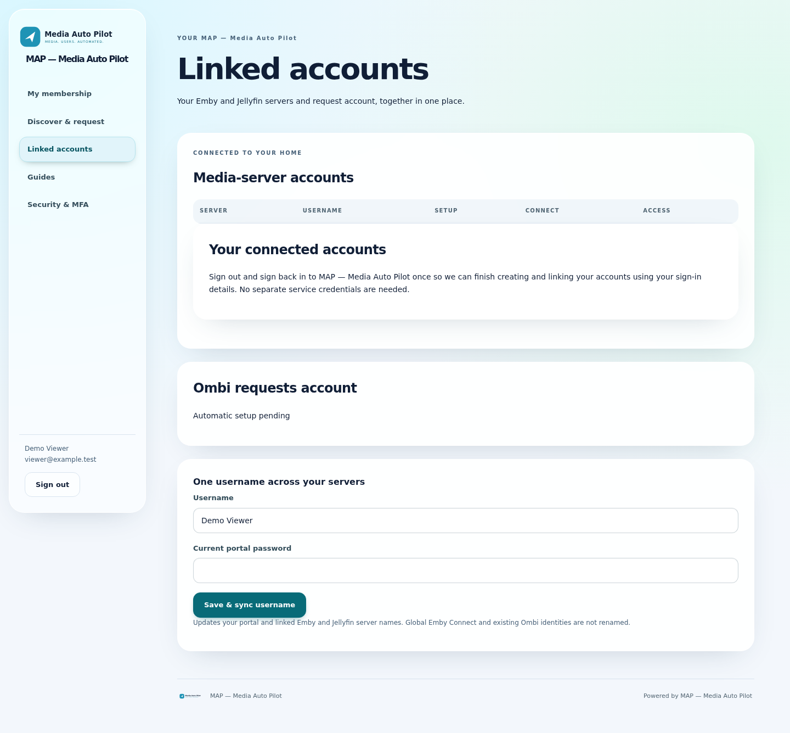
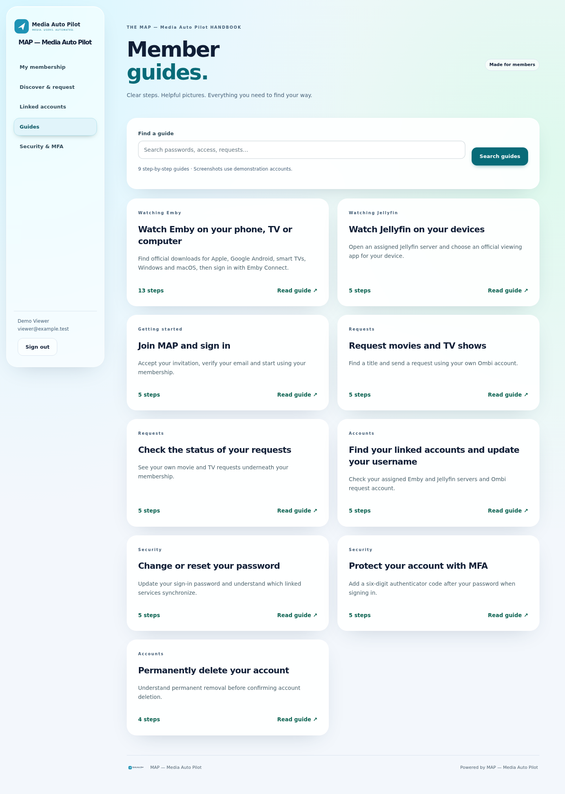
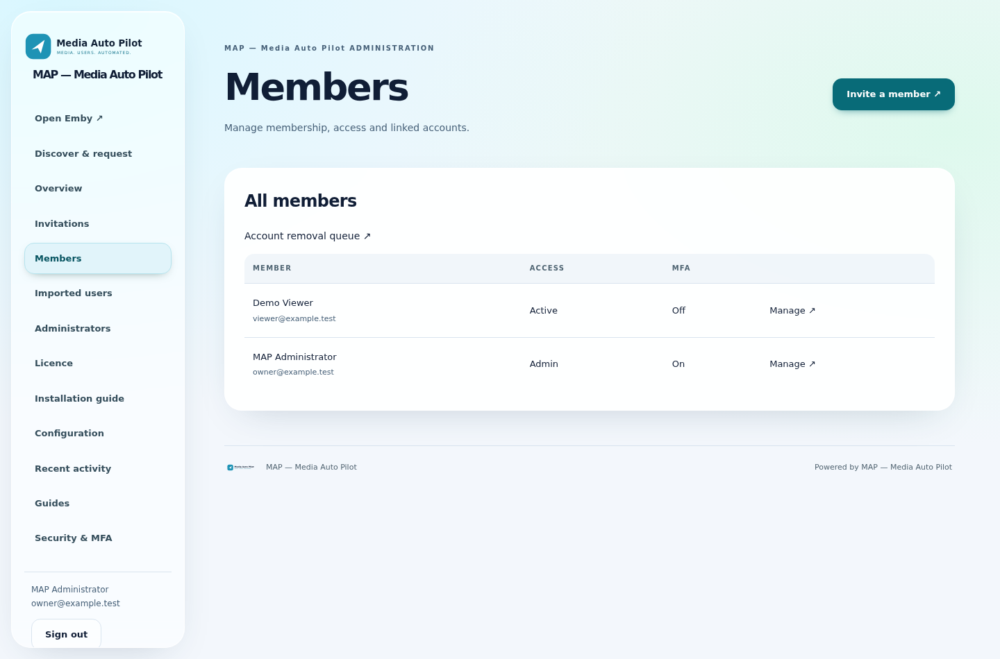
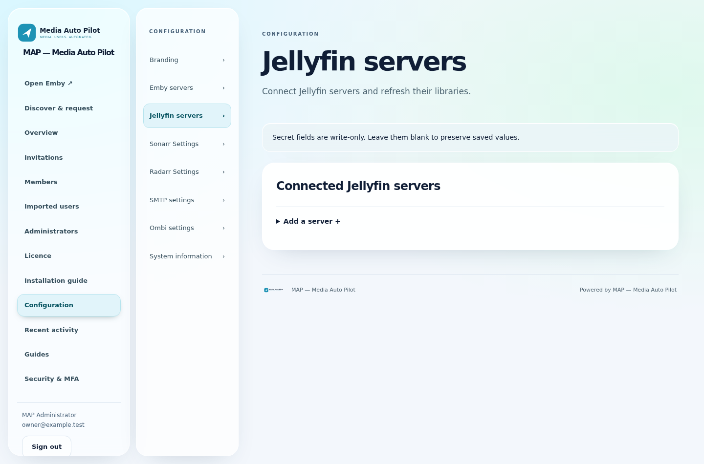
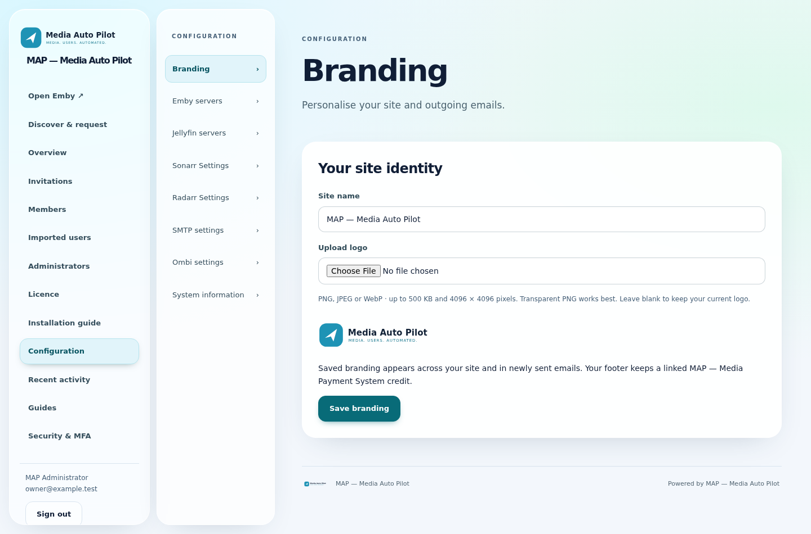
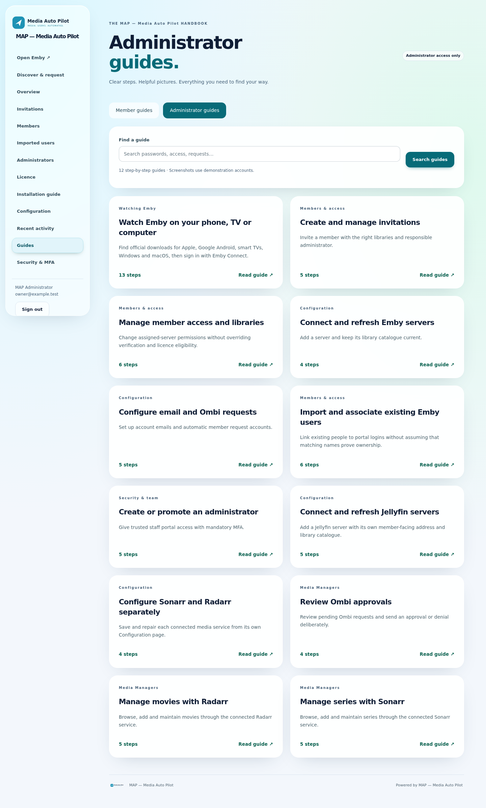

<p align="center">
  
</p>

<h1 align="center">Media Auto Pilot</h1>
<p align="center"><strong>Media. Users. Automated.</strong><br>Self-hosted Emby and Jellyfin account management.</p>
<p align="center">
  <a href="https://www.mediaautopilot.co.uk">Website</a> ·
  <a href="https://github.com/matty03072/MediaAutoPilot-Store/releases/tag/installers-1.0.2">Download 1.0.2</a> ·
  <a href="https://www.mediaautopilot.co.uk/install">Installation guide</a> ·
  <a href="https://www.mediaautopilot.co.uk/map/account">Licence account</a>
</p>

---

## Your media community, on autopilot

**Send an invitation. Your member signs up. MAP handles the normal account setup and access across your connected services.**

Media Auto Pilot brings invitations, media-server accounts, library permissions, requests and account maintenance into one portal on your own server. Connect **Emby, Jellyfin, Emby Connect, Ombi, Sonarr, Radarr and SMTP email** once, then manage your community from one place.

[Automatic setup](#automatic-setup-from-one-invitation) · [Interface gallery](#interface-gallery) · [Install](#install) · [Licensing](#free-for-ten-members-room-to-grow) · [Support](#help-and-support)

## Download MAP 1.0.2

| Platform | Download | Details |
|---|---|---|
| **Windows x64** | [Download installer](https://github.com/matty03072/MediaAutoPilot-Store/releases/download/installers-1.0.2/MAP-1.0.2-windows-x64-setup.exe) | Standalone setup; run as administrator |
| **Ubuntu 24.04 x64** | [Download archive](https://github.com/matty03072/MediaAutoPilot-Store/releases/download/installers-1.0.2/MAP-1.0.2-linux-x64.tar.gz) | systemd and CPython 3.12 required |
| **umbrelOS community store** | [Installation steps](#umbrelos) | AMD64 and ARM64 images; separate community preview |

[SHA-256 checksums](https://github.com/matty03072/MediaAutoPilot-Store/releases/download/installers-1.0.2/SHA256SUMS.txt) · [Release notes](docs/RELEASE-1.0.2.md)

**MAP is a separate installation, not an MPS update.** Do not install it over MPS or share MPS databases, configuration or state folders.

## Automatic setup from one invitation

After the administrator connects the services, the member completes their invitation and verifies their email. MAP coordinates the normal setup:

1. **Create media accounts** on the selected Emby and Jellyfin servers.
2. **Apply access permissions** for the assigned libraries and optional Live TV access.
3. **Link Emby Connect where needed** for Emby. Jellyfin uses local server accounts and does not require Emby Connect.
4. **Create or link the Ombi account** for discovery and media requests.
5. **Show the member their assigned services** from a single portal.

No routine manual account creation or Ombi setup is needed for each new member. The administrator configures the connections and invitation permissions; MAP handles the normal onboarding flow.

Emby Connect can still require member email verification. Existing-account conflicts, unavailable services and provider errors can require attention. MAP coordinates your services; it does not replace them or configure the server connections for you.

## Automation beyond signup

| Capability | What MAP does |
|---|---|
| **Invitations and permissions** | Assign servers, libraries and optional Live TV access as part of onboarding. |
| **Linked account management** | Show account setup and connection status across the member’s assigned services. |
| **Password synchronization** | Propagate completed portal password changes to linked supported server accounts and Ombi. Emby Connect credentials remain a separate boundary. |
| **Account cleanup** | Coordinate linked-account removal through the portal’s account-deletion workflow. |
| **Discover and request** | Connect Ombi for member discovery, requests and request preferences. |
| **Request progress** | Show download/import progress with connected Sonarr and Radarr services. |
| **Administrator media tools** | Manage connected movie and television services from the portal. |
| **Email and account security** | Use your SMTP service for account messages, with administrator MFA and protected administration routes. |

Available actions depend on the services you connect and the permissions assigned to each member.

## Interface gallery

These screenshots show the **MAP 1.0.2 application running with isolated demonstration accounts**. They contain no live customer data or connected-service credentials. They are source-fixture captures, not screenshots of an installed compiled package; service-dependent screens will reflect your own setup.

### Member dashboard

A personal starting point with shortcuts to assigned services and account features. Members can reach their linked accounts, help and security settings from the portal.


### Linked service accounts

Review account setup and connection status for assigned media services. This unconnected demo shows the pending-setup state. Emby Connect applies to Emby; Jellyfin uses local server accounts.



### Member guides

Built-in guidance helps members understand their accounts and connected services without needing access to administrator settings.



### Administrator overview

A central view of invitations, members and connected services, with quick access to the tools used to manage your community.


### Invitations and library access

Invite members and assign their server access. MAP keeps onboarding focused on accounts and permissions, without monthly membership-plan or revenue-attribution controls.


### Member management

Review your community and open individual member-management tools from one administrator screen.



### Jellyfin server configuration

Connect your Jellyfin servers and refresh their libraries before assigning access through invitations. Emby has its own server configuration area.



### Your own branding

Open **Configuration → Branding** to upload a logo and set your site name. Your saved branding is used by the site and new emails, with the MAP credit retained in the footer.



### Administrator guides

Role-restricted guides cover configuration and administration. Member and administrator help are kept separate.



## Install

### Windows x64

1. [Download the MAP 1.0.2 installer](https://github.com/matty03072/MediaAutoPilot-Store/releases/download/installers-1.0.2/MAP-1.0.2-windows-x64-setup.exe) and check its [SHA-256 hash](https://github.com/matty03072/MediaAutoPilot-Store/releases/download/installers-1.0.2/SHA256SUMS.txt).
2. Run the installer as administrator. The installer is unsigned.
3. Follow setup. A new standalone installation uses SQLite; see the [installation guide](https://www.mediaautopilot.co.uk/install).
4. Open **http://localhost:8099/setup**. Read the one-hour setup code from `C:\ProgramData\MAP\data\setup-code.txt` using an elevated text editor, then claim your owner account and enrol MFA.
5. Configure your own media services, outgoing email and invitation permissions.

MAP uses its own service names and data directories. Do not point it at an MPS database. External database installation acceptance is not established by the SQLite-based release checks; see the release notes before choosing that deployment.

### Linux — Ubuntu 24.04 x64

1. [Download the Linux archive](https://github.com/matty03072/MediaAutoPilot-Store/releases/download/installers-1.0.2/MAP-1.0.2-linux-x64.tar.gz) and verify the checksum.
2. Extract it and open a terminal in the extracted directory.
3. With **systemd and CPython 3.12** available, run:

   ```bash
   sudo bash install.sh
   ```

4. Open **http://localhost:8099/setup**. Read the one-hour setup code with `sudo cat /var/lib/map/setup-code.txt`, then claim your owner account and enrol MFA.

The Linux installation uses `/opt/map`, `/etc/map` and `/var/lib/map`. Keep the configuration, encryption key and database together in backups. Follow the README included in the archive for platform-specific instructions.

### umbrelOS

1. Open **App Store → Community App Stores** in Umbrel.
2. Add this repository:

   ```text
   https://github.com/matty03072/MediaAutoPilot-Store
   ```

3. Install **Media Auto Pilot** from the community store.
4. Open MAP. Unlock first-run setup with username `owner` and the app password shown by Umbrel.
5. Create your permanent owner account and enrol MFA with an authenticator.

**App ID:** `mediaautopilot-map` · **Port:** `18100` · **Architectures:** AMD64 / ARM64

MAP has a separate Umbrel app identity and storage, so it can coexist with MPS. This is an independent community preview, **not an official Umbrel App Store release**. Container pull/runtime checks passed on both architectures; an actual on-device umbrelOS install, reboot and backup/restore still need verification.

### Public access and backups

Standalone installers do not configure your public domain, HTTPS or firewall. Umbrel’s default authentication protects the app; public member invitations require a separately configured HTTPS route. Configure public access deliberately before sharing invitation links.

Back up the complete application data and configuration, including the encryption key. Never share the same state directory between MAP and MPS.

## Free for ten members. Room to grow.

| MAP software licence | Included |
|---|---|
| **Free** | Up to ten managed members |
| **£5/month** | Unlock more than ten members on up to three MAP installations |

This is an **administrator’s software licence**. MAP does not include charging members for access, member subscription plans or member-payment processing.

[Purchase a MAP licence](https://www.mediaautopilot.co.uk/map) · [Manage your licence](https://www.mediaautopilot.co.uk/map/account) · [Licence terms](https://www.mediaautopilot.co.uk/map/terms)

Paid access requires periodic online licence checks. If the subscription ends, MAP returns to the ten-member tier and retains account records. Review the [cancellation and refund policy](https://www.mediaautopilot.co.uk/map/cancellation) for renewal and cancellation details.

## Privacy and distribution

Free and licensed installations report an installation identifier, app version, timestamp and verification signature. Member details, media activity and integration credentials are not included in installation activity reports. See the [privacy notice](https://www.mediaautopilot.co.uk/map/privacy).

This public repository contains **distribution metadata, documentation, screenshots and compiled downloads—not first-party application source**. Application source is maintained privately. Runtime modules are compiled and audited for source/bytecode exclusion; compilation is not a guarantee against reverse engineering. See the [software licence](LICENSE).

## Help and support

- [Installation guide](https://www.mediaautopilot.co.uk/install)
- [Release notes and verification limits](docs/RELEASE-1.0.2.md)
- [Downloads and checksums](https://github.com/matty03072/MediaAutoPilot-Store/releases/tag/installers-1.0.2)
- [Signed-in licence support](https://www.mediaautopilot.co.uk/map/support)
- [Report an issue](https://github.com/matty03072/MediaAutoPilot-Store/issues) — do not include credentials or private member information.

MAP is an independent project. Emby, Jellyfin, Ombi, Sonarr, Radarr and Umbrel names belong to their respective owners; integration does not imply endorsement.
